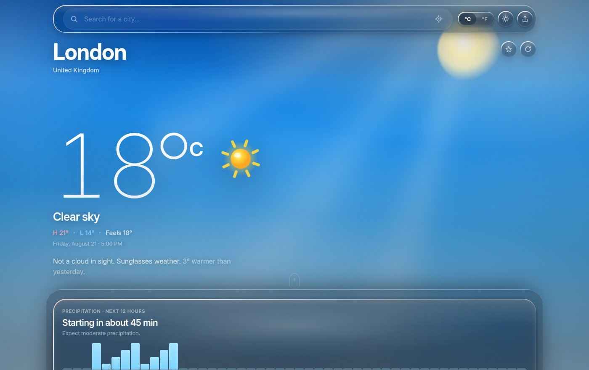

# Aurora Weather

A weather app built around a liquid-glass interface and a live, condition-aware
sky. No API key, no signup — clone it and it runs.



## Why there is no API key

Weather comes from [Open-Meteo](https://open-meteo.com), which is free for
non-commercial use and needs no registration. One request returns current
conditions, 24 hourly steps, a 10-day outlook, 15-minute precipitation, and
yesterday's readings; air quality and pollen come from a second endpoint.
Moon phase is computed locally.

## Features

**Forecasting**

- Minute-scale precipitation nowcast — "starting in about 20 minutes", drawn
  from 15-minute buckets over the next 12 hours
- 24-hour strip, 48-hour trend curve with precipitation probability
- 10-day outlook; every row expands to that day's hourly breakdown, sun times,
  wind, UV peak and rainfall total
- A 24-hour dial showing the whole day as one shape: temperature as a ring,
  daylight as an arc, precipitation as spokes
- Comparison against yesterday, and daylight gained or lost

**Conditions**

- UV index, wind speed with a compass, sunrise/sunset arc, air quality,
  humidity, apparent temperature, visibility, pressure, dew point
- Moon phase with illumination, daylight length
- Pollen counts where Open-Meteo covers them

**Interface**

- Glass surfaces with backdrop refraction, chromatic edge lensing and
  pointer-tracked specular highlights
- The sky is generated from the current condition and the location's own
  sunrise and sunset: mesh gradients, god rays, and canvas particle systems for
  rain, drizzle, snow, fog, cloud and stars, all steered by the real wind vector
- Light and dark themes; every animation respects `prefers-reduced-motion`

**Everything else**

- Search with keyboard navigation, or use your location
- Save cities; the app remembers where you were
- °C/°F toggle, shareable links, `/` to search, `R` to refresh, `U` for units
- Installable, and works offline against the last reading you loaded

## Getting started

```sh
npm install
npm run dev
```

That is the whole setup. There is no `.env` to create.

| Script | Does |
| --- | --- |
| `npm run dev` | Development server |
| `npm run build` | Production build into `build/`, then generates the service worker |
| `npm run preview` | Serve the production build |
| `npm test` | Run the test suite |
| `npm run coverage` | Test suite with coverage |
| `npm run format` | Format with Prettier |

## Architecture

```
src/
  lib/          API client, WMO code mapping, sky palettes, formatting,
                nowcast, astronomy, storage, URL state
  hooks/        Data fetching, saved cities, geolocation, pointer and
                scroll tracking, reduced-motion
  components/   UI
  styles/       Design tokens, glass material, per-component styles
scripts/
  build-sw.js   Generates the service worker from the built output
```

`lib/` holds no React and is unit-tested directly. `components/` reads from the
normalised shape `lib/api.js` returns, so a change to the upstream API is
absorbed in one place.

The service worker is generated rather than pulled from Workbox: it precaches
the built shell, serves weather responses network-first with a cache fallback,
and falls back to the app shell for navigations. Keeping it hand-written keeps
the dependency tree at two runtime packages.

## Testing

```sh
npm test
```

110 tests cover the API normaliser, nowcast logic, astronomy, sky palettes,
formatting, storage, URL state, the hooks, and the components. The build is
additionally checked in a real browser across five conditions, both themes,
mobile, and a genuine offline cold start.

## Credits

- [Open-Meteo](https://open-meteo.com) — weather, air quality and geocoding
- [BigDataCloud](https://www.bigdatacloud.com) — reverse geocoding
- [Inter](https://rsms.me/inter/) — typeface

Originally a Create React App project by
[@denniskigen](https://github.com/denniskigen).

## Licence

MIT
